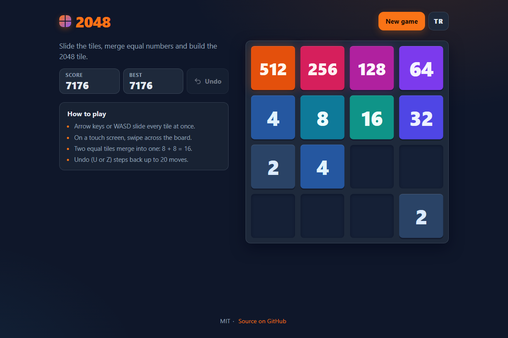

# 2048 - slide the tiles, merge equal numbers, reach 2048

[](#tests)
[](LICENSE)

**▶ Play now: https://celaldrg.github.io/2048/**



A small, polished take on the 2048 sliding-tile puzzle. It is plain HTML, CSS and JavaScript (ES modules), with no frameworks, no build step and no runtime dependencies.

## Features

- Classic 4×4 rules: every tile merges at most once per move, starting from the side you move towards (`[2,2,2,2]` becomes `[4,4]`).
- Smooth slide, merge-pop and new-tile animations, plus a "+N" score float. All motion is reduced when your system asks for it.
- Multi-step undo (up to 20 moves) that restores the board, the score and the random tile sequence.
- Your best score and the current game are saved in the browser, so a reload continues where you left off.
- Win screen at 2048 with "Keep playing", and a game-over screen when no move is left.
- Original colour palette: cool blues, teals and violets that warm up into orange.
- English and Turkish. The choice is remembered.
- Mobile first: playable at 375 px wide with touch, and with the keyboard on desktop.

## How to play

| Action | Keyboard | Touch / mouse |
| --- | --- | --- |
| Slide all tiles | Arrow keys or `W` `A` `S` `D` | Swipe (or drag) across the board |
| Undo | `U` or `Z` | **Undo** button |
| New game | - | **New game** button |
| Language | - | **TR** / **EN** button |

Two tiles with the same number merge into one when they slide into each other. After every move that changes the board, a new 2 (90%) or 4 (10%) appears in an empty cell. Build the 2048 tile to win, then keep going for a higher score.

## Run locally

ES modules need to be served over `http://`; opening `index.html` from `file://` will not work. Any static server will do, for example:

```sh
npx serve .
```

Then open the address it prints. `?demo` (for example `http://localhost:3000/?demo`) shows a fixed mid-game position. It is used for the screenshot and never touches your saved game.

## Tests

```sh
node --test
```

The tests need Node.js 18 or newer and have no dependencies. They cover:

- the merge rules, including `[2,2,2,2] -> [4,4,0,0]`, `[2,2,4,0]`, `[4,4,4,0]`, `[2,0,2,2]` and `[8,8,16,16]`, in all four directions;
- that a move which changes nothing does not spawn a tile or use a random number, and that tiles only spawn into empty cells (about 10% of them are 4s);
- game-over detection, and a win that fires exactly once (plus "keep playing");
- that a winning move which also ends the game shows the win overlay first and game over after "keep playing", and that undo waits while the win overlay is open;
- that undo restores board, score, tile ids and RNG state exactly (15 steps), and that the undo limit holds;
- save/restore through JSON and rejection of corrupt save data;
- the seeded RNG, the demo position and the storage helper (which never throws);
- matching English/Turkish strings, and that every string in `index.html` goes through the translation table;
- the keyboard and swipe mapping;
- that every tile value up to 131072 has its own colour in `style.css`.

## Project structure

```text
index.html          page shell, meta tags, favicon
style.css           dark theme, board, tiles, animations
src/
  rng.js            seeded random numbers (mulberry32)
  board.js          pure slide-and-merge rules
  game.js           spawning, score, win, game over, undo, save data
  demo.js           fixed ?demo position
  storage.js        localStorage helper that never throws
  i18n.js           English and Turkish strings
  controls.js       key and swipe mapping
  overlay.js        which overlay shows, and when undo is allowed
  view.js           DOM board with animated tiles
  input.js          keyboard and pointer listeners
  main.js           connects everything on the page
test/               node:test suites
docs/screenshot.png
```

Game logic (`rng`, `board`, `game`, `demo`, `storage`, `i18n`, `controls`, `overlay`) is pure and has no DOM access at import time, so Node can test it directly.

## License

[MIT](LICENSE) © 2026 Celalettin Durgaç

---

## Türkçe

2048 kaydırmalı sayı bulmacasının küçük ve özenli bir sürümü. Düz HTML, CSS ve JavaScript (ES modülleri) ile yazıldı. Çatı (framework), derleme adımı ya da çalışma zamanı bağımlılığı yok.

**▶ Hemen oyna: https://celaldrg.github.io/2048/**

### Özellikler

- Klasik 4×4 kurallar: her taş bir hamlede en fazla bir kez birleşir ve birleşme hareket yönündeki kenardan başlar (`[2,2,2,2]` → `[4,4]`).
- Akıcı kayma, birleşme ve yeni taş animasyonları, skor için "+N" efekti. Sistemin hareketi azalt ayarı açıksa animasyonlar kısılır.
- Çok adımlı geri alma (20 hamleye kadar). Tahtayı, skoru ve rastgele taş sırasını geri getirir.
- En iyi skor ve süren oyun tarayıcıda saklanır. Sayfayı yenilediğinde kaldığın yerden devam edersin.
- 2048'de kazanma ekranı ("Devam et" seçeneğiyle) ve hamle kalmayınca oyun bitti ekranı.
- Özgün renk paleti: soğuk mavi, turkuaz ve mor tonlar, büyüdükçe turuncuya ısınır.
- İngilizce ve Türkçe. Seçimin hatırlanır.
- Önce mobil: 375 px genişlikte dokunarak, masaüstünde klavyeyle oynanır.

### Nasıl oynanır

| İşlem | Klavye | Dokunmatik / fare |
| --- | --- | --- |
| Tüm taşları kaydır | Ok tuşları veya `W` `A` `S` `D` | Tahtanın üzerinde parmağını (ya da fareyi) kaydır |
| Geri al | `U` veya `Z` | **Geri al** düğmesi |
| Yeni oyun | - | **Yeni oyun** düğmesi |
| Dil | - | **TR** / **EN** düğmesi |

Aynı sayıdaki iki taş birbirine doğru kayınca tek taşa dönüşür. Tahtayı değiştiren her hamleden sonra boş bir kareye yeni bir 2 (%90) ya da 4 (%10) gelir. 2048 taşını yapınca kazanırsın, sonra daha yüksek skor için devam edebilirsin.

### Yerelde çalıştırma

ES modülleri `http://` üzerinden sunulmalıdır. `index.html` dosyasını `file://` ile açmak çalışmaz. Herhangi bir statik sunucu yeter, örneğin:

```sh
npx serve .
```

Sonra yazdığı adresi aç. `?demo` (örneğin `http://localhost:3000/?demo`) sabit bir oyun ortası konumu gösterir. Ekran görüntüsü için kullanılır ve kayıtlı oyununa dokunmaz.

### Testler

```sh
node --test
```

Testler Node.js 18 veya üstü ister ve bağımlılık gerektirmez. Kapsananlar:

- birleşme kuralları, dört yönde de: `[2,2,2,2] -> [4,4,0,0]`, `[2,2,4,0]`, `[4,4,4,0]`, `[2,0,2,2]` ve `[8,8,16,16]`;
- tahtayı değiştirmeyen hamlenin taş üretmemesi ve rastgele sayı harcamaması, yeni taşların yalnızca boş karelere gelmesi (yaklaşık %10'u 4);
- oyun bitti tespiti ve yalnızca bir kez tetiklenen kazanma (ayrıca "devam et");
- kazandıran hamle oyunu da bitirirse önce kazanma ekranının, "devam et"ten sonra oyun bitti ekranının gelmesi ve kazanma ekranı açıkken geri almanın beklemesi;
- geri almanın tahtayı, skoru, taş kimliklerini ve RNG durumunu birebir geri getirmesi (15 adım) ve geri alma sınırı;
- JSON üzerinden kaydetme/yükleme ve bozuk kayıt verisinin reddedilmesi;
- tohumlu RNG, demo konumu ve hiç hata fırlatmayan depolama yardımcısı;
- İngilizce/Türkçe metinlerin eşleşmesi ve `index.html` içindeki her metnin çeviri tablosundan geçmesi;
- klavye ve kaydırma eşlemesi;
- 131072'ye kadar her taş değerinin `style.css` içinde kendine ait bir rengi olması.

### Lisans

[MIT](LICENSE) © 2026 Celalettin Durgaç
